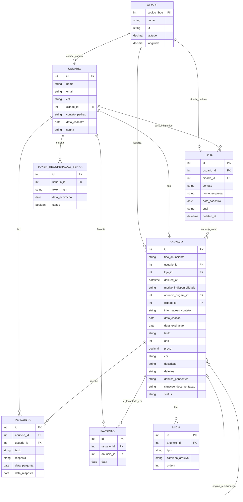
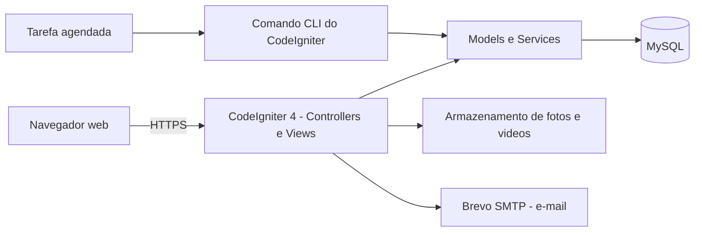
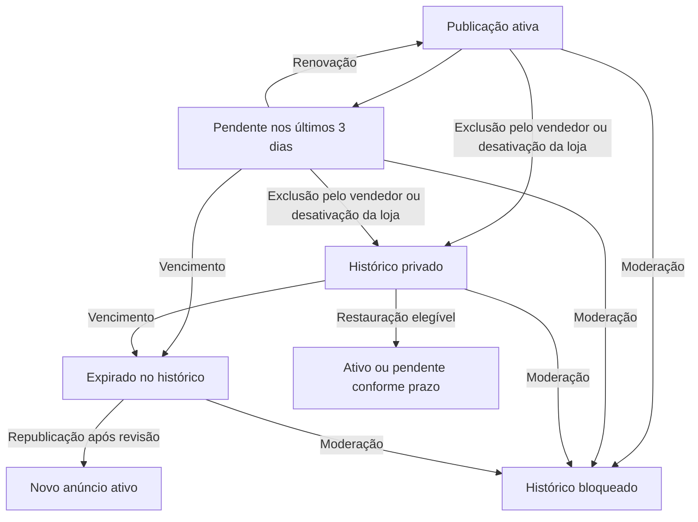

# BargainCar

## 1. Visão Geral / Escopo

**O que é o sistema**

O BargainCar é uma aplicação de anúncios de venda, disponível exclusivamente na web, com foco regional. O sistema permite que usuários criem anúncios de carros para venda, incluindo informações do veículo, descrição e preço, e que outros usuários visualizem os anúncios de veículos disponíveis próximos à sua localização.

**Público-alvo**

Pessoas que querem vender um veículo que não usam mais, pequenos empreendedores ou empresas que querem alcançar mais clientes em sua região.

**Problema que resolve**

Sistemas de anúncios de venda frequentemente exibem produtos que despertam o interesse do usuário, mas que são geograficamente inviáveis devido à distância. O BargainCar também busca resolver o problema de pequenos empreendedores que têm dificuldade em alcançar clientes dentro de sua própria região.

**Escopo da v1**

- Criação de anúncios de venda de carros, contendo informações do veículo, descrição e preço.
- Filtragem e exibição de anúncios por proximidade geográfica (cidade de origem do usuário + cidades vizinhas).
- A negociação e a efetivação da venda ocorrem fora da plataforma (o sistema não processa pagamentos).
- Sistema de expiração de anúncios: cada anúncio permanece ativo por 30 dias.
- Três dias antes do fim do período, o anúncio entra em estado pendente e o vendedor recebe uma notificação (por e-mail) perguntando se o veículo ainda está à venda.
- Caso o vendedor confirme, o anúncio é renovado por mais 30 dias. Caso não responda até o fim do prazo, o anúncio expira automaticamente.
- Perfil de Loja (empresa), vinculado a um Usuário, com dados próprios separados do perfil pessoal.

- Histórico privado de anúncios pessoais e de cada loja, com restauração de anúncios ainda válidos e republicação de anúncios vencidos.

*Observação: embora a v1 seja restrita à categoria de veículos, o sistema deve ser modelado pensando em uma futura expansão para outras categorias de produtos.*

**Fora do escopo da v1**

- Aplicativos nativos para Android e iOS; o sistema será acessado pelo navegador, inclusive em dispositivos móveis.
- Notificações push no navegador (possível evolução futura).
- Pagamento ou checkout dentro da plataforma.
- Integração com calendário.
- Sistema de anúncios pagos/destaque para lojas.

---

## 2. Requisitos Funcionais e Não Funcionais

**Requisitos Funcionais (RF)**

- RF01: O sistema deve permitir que o usuário crie uma conta com nome, e-mail, CPF, cidade padrão, contato padrão e senha.
- RF02: O sistema deve mostrar somente o nome, fotos, anúncios ativos e o tempo de criação da conta para as pessoas que estiverem vendo o perfil do usuário.
- RF03: O sistema deve permitir que o usuário crie seus anúncios com informações básicas como ano, preço e cor, além de descrição do veículo, incluindo defeitos, débitos pendentes e situação da documentação.
- RF04: O sistema deve permitir fotos e, opcionalmente, um vídeo ao anúncio; são obrigatórias de 3 a 5 fotos para publicação.
- RF05: O sistema deve permitir que o usuário defina a localização e o contato do anúncio, podendo usar a localização e contato padrão do perfil ou escolher outro.
- RF06: O sistema deve permitir que o usuário marque anúncios pelos quais está interessado.
- RF07: O sistema deve permitir que o usuário envie e responda perguntas (que serão públicas) nos anúncios.
- RF08: O sistema deve notificar o vendedor por e-mail quando o anúncio estiver a 3 dias de expirar, perguntando se o veículo ainda está à venda.
- RF09: O sistema deve renovar o anúncio por mais 30 dias caso o vendedor confirme que o veículo ainda está à venda, ou expirá-lo automaticamente caso não haja resposta.
- RF10: O sistema deve exibir automaticamente anúncios de cidades próximas à cidade padrão do usuário.
- RF11: O sistema deve permitir que o usuário busque anúncios por título, cidade e distância máxima em relação à cidade padrão ou à cidade pesquisada.
- RF12: O sistema deve permitir que o usuário edite e exclua seus próprios anúncios.
- RF13: O sistema deve permitir que o usuário crie um perfil de Loja (empresa), com contato, localização padrão, nome da empresa e CNPJ opcional.
- RF14: O sistema deve permitir que o dono do anúncio exclua perguntas feitas no seu anúncio (ex: perguntas ofensivas), e que o autor exclua as próprias perguntas.
- RF15: O sistema deve permitir que o usuário faça login com CPF e senha, em uma tela separada da tela de criar conta.
- RF16: O sistema deve permitir que o usuário recupere a senha por e-mail, caso a tenha esquecido.
- RF17: O sistema deve permitir que o usuário, estando logado e possuindo uma Loja, alterne entre navegar como pessoa física ou como loja, usando a mesma conta.
- RF18: Visitantes não autenticados podem buscar, listar e visualizar anúncios e perfis públicos.
- RF19: O sistema deve permitir a exclusão lógica de anúncios pelo proprietário, retirando-os das buscas e mantendo a referência de favoritos indisponíveis.
- RF20: O sistema deve permitir que o usuário mostre ou oculte a senha digitada por meio de um ícone de olho nos campos de senha (cadastro, login e redefinição).
- RF21: O sistema deve bloquear temporariamente o login após 5 tentativas incorretas consecutivas, recusando novas tentativas por 1 minuto.

- RF22: Exibir histórico privado em Meu Perfil e Perfil da Loja, separado dos anúncios atuais e por identidade anunciante.
- RF23: Permitir restauração confirmada de anúncios excluídos ainda válidos, preservando ID, mídias, favoritos, perguntas e prazo.
- RF24: Permitir republicação de anúncios vencidos mediante revisão e nova validação, criando novo ID e validade de 30 dias, sem transferir interações.
- RF25: Excluir logicamente anúncios disponíveis na desativação da loja e permitir operações manuais somente após reativação da mesma loja.
- RF26: Impedir restauração e republicação pelo vendedor de anúncios removidos por moderação.

**Requisitos Não Funcionais (RNF)**

- RNF01: O sistema deve exigir autenticação para acessar áreas restritas (ex: editar perfil).
- RNF02: Páginas devem carregar em no máximo 3 segundos com conexão de internet padrão.
- RNF03: Imagens enviadas pelos usuários devem ser comprimidas automaticamente para otimizar o carregamento.
- RNF04: A interface deve ser responsiva, adaptando-se a celulares, tablets e desktops.
- RNF05: O sistema deve suportar crescimento de usuários sem perda significativa de performance.
- RNF06: Arquivos de mídia devem ter limite de tamanho por upload: fotos em JPG, PNG ou WebP até 5 MB cada; vídeo em MP4 até 50 MB.
- RNF07: As senhas dos usuários devem ser armazenadas como hashes seguros, nunca em texto puro ou criptografia reversível.
- RNF07.1: Os formulários de criação e redefinição de senha devem validar no servidor o mínimo de 8 caracteres e pelo menos uma letra maiúscula de A a Z; letras minúsculas, números e símbolos são permitidos, mas não obrigatórios.
- RNF07.2: O ícone de olho deve alternar a visibilidade do texto digitado sem modificar a senha, com indicação acessível do estado mostrar/ocultar.
- RNF08: Formulários e ações de alteração de estado devem utilizar proteção CSRF e validação de entradas.
- RNF09: CPF e e-mail devem ser únicos, normalizados e protegidos contra exposição indevida.
- RNF10: O login deve bloquear novas tentativas por 1 minuto após 5 tentativas incorretas consecutivas, inclusive quando a senha correta for informada durante o bloqueio. O contador deve ser zerado após autenticação bem-sucedida antes do limite. A verificação e o bloqueio devem ser aplicados no servidor, com armazenamento temporário seguro e cookies de sessão seguros.
- RNF11: Uploads devem validar tamanho, tipo real, extensão e permissões de acesso; arquivos devem receber nomes gerados pelo servidor.
- RNF12: O tratamento de dados pessoais deve respeitar princípios da LGPD, incluindo finalidade, minimização, transparência e política de retenção e exclusão.

---

**Requisitos complementares de segurança**

- RNF13: Autorizar no servidor cada consulta privada e operação pelo proprietário, tipo de anunciante e loja original; usar POST com CSRF para restauração e republicação, inclusive preparação de formulário por POST. Revalidar estado e validade na confirmação.
- RNF14: Servir mídias por acesso controlado, sem URLs públicas diretas para arquivos indisponíveis; impedir acesso por cache público e por manipulação de IDs. Aplicar retenção e LGPD também às cópias e históricos.
- RNF15: Usar transações, controle de concorrência e proteção contra submissão duplicada nas mudanças de estado e republicação; limpar arquivos temporários em caso de falha.

## 3. Casos de Uso

### Caso de Uso: Criar Anúncio
**Ator:** Usuário
**Pré-condição:** Usuário está autenticado (CPF e senha)
**Fluxo principal:**
1. Usuário clica em "Novo Anúncio"
2. Usuário preenche título do anúncio, descrição, informações de contato, de 3 a 5 fotos (vídeo opcional)
3. Usuário clica em "Salvar"
4. Sistema exibe o anúncio no perfil do usuário e na lista de anúncios para a região do anúncio

**Fluxo alternativo:** Se o título estiver vazio ou o anúncio tiver menos de 3 ou mais de 5 fotos, sistema exibe erro e não salva.

### Caso de Uso: Login
**Ator:** Usuário
**Pré-condição:** Usuário possui conta cadastrada
**Fluxo principal:**
1. Usuário acessa a tela de login (separada da tela de criar conta)
2. Usuário informa CPF e senha; pode mostrar ou ocultar a senha pelo ícone de olho
3. Usuário clica em "Entrar"
4. Sistema valida as credenciais e redireciona o usuário para a página inicial, autenticado

**Fluxo alternativo:** Se o CPF ou a senha estiverem incorretos, o sistema exibe uma mensagem genérica e registra a tentativa incorreta. Ao atingir a quinta tentativa incorreta consecutiva, o login é bloqueado por 1 minuto. Durante o bloqueio, qualquer nova tentativa é recusada, mesmo que a senha informada esteja correta. Terminado o minuto, o usuário pode tentar novamente, com o contador reiniciado. Se o usuário acertar a senha antes de atingir 5 erros, o contador é zerado. Um link "Esqueci minha senha" leva ao caso de uso de recuperação.

### Caso de Uso: Recuperar Senha
**Ator:** Usuário
**Pré-condição:** Usuário possui conta cadastrada
**Fluxo principal:**
1. Usuário clica em "Esqueci minha senha" na tela de login
2. Usuário informa o e-mail cadastrado
3. Usuário clica em "Enviar link"
4. Sistema exibe a mensagem "Se esse e-mail estiver cadastrado, você vai receber um link em instantes. Confira também a caixa de spam e verifique se digitou o e-mail corretamente."
5. Usuário acessa o link recebido, define uma nova senha com no mínimo 8 caracteres e pelo menos uma letra maiúscula (A–Z), podendo mostrar ou ocultar a digitação pelo ícone de olho, e é redirecionado para o login

**Fluxo alternativo:** A mensagem do passo 4 é sempre a mesma, exista ou não aquele e-mail no sistema — o sistema nunca confirma nem nega se um e-mail está cadastrado. O link de redefinição expira após um tempo determinado.

### Caso de Uso: Alternar para Loja
**Ator:** Usuário (com Loja cadastrada)
**Pré-condição:** Usuário está autenticado e possui uma Loja
**Fluxo principal:**
1. Usuário clica no seletor de perfil (pessoa/loja)
2. Usuário seleciona "Loja"
3. Sistema passa a exibir a área da loja (anúncios, dados e perfil público da loja)
4. Usuário pode voltar ao modo pessoa a qualquer momento, pelo mesmo seletor

**Fluxo alternativo:** Se o usuário não tiver uma Loja ativa, o seletor não exibe a opção "Loja", apenas um convite para criar uma.

### Caso de Uso: Criar Loja
**Ator:** Usuário
**Pré-condição:** Usuário está autenticado
**Fluxo principal:**
1. Usuário clica em "Nova Empresa"
2. Usuário preenche os dados da empresa (contato, localização padrão, nome da empresa e, opcionalmente, CNPJ)
3. Usuário clica em "Salvar"
4. Sistema cria e exibe aquele perfil como uma loja, e passa a aceitar a criação de anúncios em nome dela

**Fluxo alternativo:** Se algum dos campos obrigatórios de "dados da Empresa" estiver vazio, sistema exibe erro e não salva.

### Caso de Uso: Excluir Anúncio
**Ator:** Usuário
**Pré-condição:** Usuário está autenticado (CPF e senha)
**Fluxo principal:**
1. Usuário clica em "Perfil"
2. Usuário seleciona o anúncio que quer excluir
3. Usuário clica em "Excluir"
4. Sistema exibe um pedido de confirmação; se aceito, registra a exclusão lógica e move o anúncio para o histórico privado, sem alterar sua validade.

**Fluxo alternativo:** Se o pedido de confirmação não for aceito ou for ignorado, o anúncio não é apagado.

### Caso de Uso: Consultar Histórico de Anúncios
**Ator:** Proprietário autenticado.
**Fluxo principal:** Acessa Meu Perfil ou Perfil da Loja e abre a seção Histórico de anúncios, separada dos anúncios atuais. Cada item mostra foto principal, título, preço, data de exclusão ou expiração, situação e ação elegível (Restaurar ou Republicar). Exibir uma única situação: Excluído, Expirado ou Removido por moderação. Para Expirado, mostrar a data de expiração; para Excluído ou Removido por moderação, mostrar a data da remoção. Anúncios pessoais e de cada loja são consultados separadamente. O proprietário pode consultar o histórico de uma loja desativada em área privada, sem executar ações de publicação.
**Fluxo alternativo:** Histórico vazio exibe mensagem informativa; acesso de terceiros é recusado. Itens moderados não oferecem ações de publicação.

### Caso de Uso: Restaurar Anúncio
**Ator:** Proprietário autenticado.
**Pré-condição:** Anúncio excluído pelo vendedor ou pela desativação da loja, ainda dentro da validade, sem bloqueio de moderação; se de loja, a mesma loja deve estar ativa.
**Fluxo principal:**
1. Proprietário seleciona Restaurar no histórico e confirma.
2. Servidor recebe POST com CSRF e verifica propriedade, identidade anunciante, validade e condições de publicação.
3. Em transação, limpa `deleted_at` e `motivo_indisponibilidade`, recalcula status ativo/pendente conforme prazo restante, preservando `data_expiracao`, ID e vínculos.
4. Anúncio volta aos anúncios atuais e à consulta pública.
**Fluxo alternativo:** Cancelamento não altera dados; se vencido, oferecer republicação quando elegível; se inválido, informar motivo e permitir correção autorizada antes de nova tentativa. Loja desativada ou moderação impede a ação.

### Caso de Uso: Republicar Anúncio
**Ator:** Proprietário autenticado.
**Pré-condição:** Anúncio expirado, inclusive aquele que foi excluído antes de expirar, sem bloqueio de moderação; mesma loja ativa quando aplicável.
**Fluxo principal:**
1. Proprietário seleciona Republicar; POST protegido prepara formulário com dados e mídias anteriores.
2. Proprietário revisa, altera dados e mídias se desejar e confirma a publicação.
3. Servidor revalida origem, autorização, prazo vencido e todos os requisitos de criação (inclusive 3 a 5 fotos e vídeo opcional).
4. Cria novo anúncio ativo, com novo ID, data de criação atual e validade de 30 dias, na mesma identidade anunciante. Cria vínculos de mídia próprios, sem copiar favoritos ou perguntas.
5. Mantém o original no histórico e exibe a nova publicação nos anúncios atuais.
**Fluxo alternativo:** Cancelamento ou falha de validação não cria publicação nem altera o original. Reenvio da mesma confirmação não cria duplicata.

### Caso de Uso: Desativar e Reativar Loja
**Ator:** Proprietário autenticado.
**Fluxo:** Ao confirmar desativação, excluir logicamente a loja e excluir logicamente seus anúncios ainda publicáveis, preservando prazo e vínculos. Preencher `deleted_at` e `motivo_indisponibilidade = exclusao_loja` nos anúncios atingidos. Não sobrescrever motivos de anúncios já indisponíveis. Ao reativar a mesma loja, verificar limite de uma loja ativa por conta; nenhum anúncio retorna automaticamente. O proprietário pode consultar o histórico e restaurar os válidos ou republicar os vencidos, conforme as regras. A conta pessoal permanece independente.

### Caso de Uso: Editar Anúncio
**Ator:** Usuário
**Pré-condição:** Usuário está autenticado (CPF e senha)
**Fluxo principal:**
1. Usuário clica em "Perfil"
2. Usuário seleciona o anúncio que quer editar
3. Usuário clica em "Editar"
4. Sistema exibe o anúncio com os dados atualizados, no perfil do usuário e na lista de anúncios da região

**Fluxo alternativo:** Se o título estiver vazio ou o anúncio ficar com menos de 3 ou mais de 5 fotos, sistema exibe erro e não salva.

### Caso de Uso: Buscar Anúncios
**Ator:** Usuário autenticado ou visitante
**Pré-condição:** Nenhuma; a busca é pública. Visitantes sem cidade de referência definida deverão selecionar uma cidade.

**Interface da barra de pesquisa:**
- Campo de texto "O que você procura?", para pesquisar pelo nome/título do anúncio.
- Campo "Cidade", com sugestões de municípios por nome e UF, selecionados pelo código IBGE (`cidade_id`). Opcional quando já existe cidade padrão disponível.
- **Novo campo "Distância"**, para selecionar o raio máximo de busca a partir da cidade de referência. Valor inicial: **100 km**. Opções predefinidas e únicas: **10, 25, 50, 75 e 100 km**; não é permitido digitar valores personalizados.
- Botão azul destacado "Buscar", com ícone de lupa. A busca somente é executada ao confirmar pelo botão.
- Os filtros de título e cidade são opcionais e independentes; a distância sempre possui um valor selecionado.

**Fluxo principal:**
1. O usuário informa opcionalmente o título e/ou seleciona uma cidade, podendo alterar a distância máxima.
2. O usuário clica em "Buscar".
3. O sistema determina a cidade de referência: cidade selecionada, se houver; caso contrário, cidade padrão do usuário autenticado. Visitantes sem referência devem selecionar uma cidade.
4. O sistema calcula a distância euclidiana local aproximada entre os centros geográficos dos municípios e inclui somente anúncios localizados dentro do raio escolhido.
5. Se houver título informado, filtra também pelo título.
6. Exibe os anúncios disponíveis que atendem a todos os filtros.

**Fluxo alternativo — nenhum anúncio encontrado:** Se a busca não retornar anúncios, o sistema exibirá a mensagem **"Nenhum anúncio encontrado nesse raio. Deseja ampliar a distância?"** e oferecerá um botão para selecionar a próxima distância predefinida maior (10 → 25 → 50 → 75 → 100 km). Ao confirmar, o sistema repetirá a busca mantendo a cidade e o termo informados. Se o raio já for de 100 km, não oferecerá ampliação e exibirá **"Nenhum anúncio encontrado em até 100 km. Tente outra cidade ou outro termo de pesquisa."** O sistema nunca ampliará o raio automaticamente sem a ação do usuário.

**Combinações de filtros:**
- **Somente título:** busca pelo título na região da cidade padrão, respeitando a distância selecionada.
- **Somente cidade:** busca anúncios próximos à cidade escolhida, respeitando a distância selecionada.
- **Título e cidade:** combina os dois filtros e a distância selecionada.
- **Somente distância alterada:** utiliza a cidade padrão como centro da busca, se disponível.
- **Nenhum filtro alterado:** utiliza a cidade padrão e a distância inicial de 100 km; visitantes sem cidade de referência devem selecioná-la.

**Regras complementares:** O raio padrão é 100 km e pode ser reduzido pelo usuário somente às opções predefinidas, sem ultrapassar 100 km. A distância é uma aproximação em linha reta, não rodoviária. A busca pública exibe somente anúncios publicáveis conforme RN13, com status `ativo` ou `pendente`. As opções definitivas são 10, 25, 50, 75 e 100 km, sendo 100 km o limite máximo.

### Caso de Uso: Selecionar Cidade
**Ator:** Usuário
**Pré-condição:** Usuário está em uma tela com campo de cidade (cadastro, criar anúncio ou busca)
**Fluxo principal:**
1. Usuário começa a digitar o nome da cidade
2. Sistema exibe uma lista de sugestões, com nome e UF (ex: "Ceres - GO")
3. Usuário seleciona uma das cidades da lista
4. Sistema guarda a cidade escolhida

**Fluxo alternativo:** Se nenhuma cidade corresponder ao texto digitado, o sistema exibe "Nenhuma cidade encontrada" e não permite avançar com texto livre.

### Caso de Uso: Visualizar Anúncio
**Ator:** Usuário
**Pré-condição:** Nenhuma; a visualização é pública
**Fluxo principal:**
1. Usuário clica em algum anúncio na página
2. Usuário lê os dados do anúncio
3. Usuário clica nas fotos
4. Sistema exibe as fotos disponíveis no anúncio

**Fluxo alternativo:** Caso o anúncio esteja indisponível (excluído, expirado, moderado ou vinculado a loja desativada), o sistema exibe a mensagem "Este anúncio não está mais disponível" e redireciona o usuário para a página de anúncios.

### Caso de Uso: Adicionar Anúncio aos Favoritos
**Ator:** Usuário
**Pré-condição:** Nenhuma; a visualização é pública
**Fluxo principal:**
1. Usuário clica em algum anúncio na página
2. Usuário lê os dados do anúncio
3. Usuário clica em "Favoritar"
4. Sistema exibe uma mensagem informando que o anúncio foi adicionado aos favoritos

**Fluxo alternativo:** Se o usuário clicar em "Favoritar" uma segunda vez, o anúncio sai da lista de favoritos.

### Caso de Uso: Ver Lista de Favoritos
**Ator:** Usuário
**Pré-condição:** Usuário está autenticado
**Fluxo principal:**
1. Usuário acessa a página "Favoritos"
2. Sistema exibe a lista de anúncios favoritados pelo usuário
3. Usuário clica em um dos anúncios da lista
4. Sistema abre o anúncio normalmente

**Fluxo alternativo:** Se o anúncio favoritado já tiver expirado ou sido excluído, ele continua aparecendo na lista de favoritos. Ao clicar, o sistema exibe a mesma mensagem "Este anúncio não está mais disponível" (RN12) e o usuário pode removê-lo dos favoritos a partir dali.

---

## 4. Modelagem de Dados

### Entidades e Atributos

**Cidade**
`codigo_ibge (PK), nome, uf, latitude, longitude`

**Usuário**
`id, nome, email, cpf, cidade_id (FK, cidade padrão), contato_padrao, data_cadastro, senha`

**Loja**
`id, usuario_id (FK), cidade_id (FK, cidade padrão da loja), contato, nome_empresa, data_cadastro, cnpj (opcional), deleted_at (opcional)`

**Anúncio**
`id, tipo_anunciante (pessoa ou loja), usuario_id (FK), loja_id (FK, opcional), deleted_at (opcional), motivo_indisponibilidade (opcional), anuncio_origem_id (FK opcional), cidade_id (FK, padrão ou variante), informacoes_contato (padrão ou variante), data_criacao, data_expiracao, titulo, ano, preco, cor, descricao, defeitos, debitos_pendentes, situacao_documentacao, status (ativo, pendente, expirado)`

**Mídia**
`id, anuncio_id (FK), tipo (foto ou video), caminho_arquivo, ordem`

**Pergunta**
`id, anuncio_id (FK), usuario_id (FK, quem perguntou), texto, resposta (vazia até o dono responder), data_pergunta, data_resposta`

**Favorito**
`id, usuario_id (FK), anuncio_id (FK), data`

**TokenRecuperacaoSenha**
`id, usuario_id (FK), token_hash, data_expiracao, usado`

### Campos adicionais propostos para a Migration de anúncios

| Campo | Tipo sugerido | Finalidade |
|---|---|---|
| `deleted_at` | DATETIME NULL (existente) | Data de exclusão ou remoção por moderação; nulo para publicação não removida. |
| `motivo_indisponibilidade` | ENUM('exclusao_vendedor','exclusao_loja','moderacao') NULL | Distingue a causa da remoção lógica e determina elegibilidade. |
| `anuncio_origem_id` | FK anulável para anúncios.id | Rastreabilidade opcional da republicação; ON DELETE SET NULL para permitir retenção/eliminação do original. |

A expiração continua representada por `status` e `data_expiracao`, sem exigir outro campo de data. O prazo deve ser verificado diretamente, mesmo se a tarefa agendada estiver atrasada. Quando um anúncio excluído atingir a data de expiração, apresentar somente a situação Expirado, preservando internamente o motivo e a data de exclusão. Não haverá situação combinada de exclusão e vencimento. Moderação tem precedência sobre os demais motivos; nunca limpar esse bloqueio em operações do vendedor. Registros legados com `deleted_at` e motivo desconhecido devem ser classificados com evidência antes de permitir restauração ou republicação; na dúvida, bloquear as ações. Indexar consultas por proprietário, tipo, loja, `deleted_at`, status e validade conforme planos de execução. Não é necessária tabela separada para o histórico de anúncios indisponíveis; ele é uma consulta privada dos registros existentes. Não se trata de auditoria de todos os eventos passados de anúncios restaurados.

As mídias republicadas devem possuir registros próprios e arquivos independentes (ou armazenamento imutável com controle de referências e autorização por anúncio). A exclusão definitiva de um anúncio não pode apagar arquivos ainda utilizados por outro.

*Notas de modelagem:*
- `Cidade` guarda latitude e longitude para calcular a distância entre cidades (ver seção Arquitetura). Os dados vêm do repositório público `kelvins/Municipios-Brasileiros` (https://github.com/kelvins/Municipios-Brasileiros), que traz código IBGE, nome, UF, latitude e longitude de 5.570 municípios, sob licença MIT (é preciso manter o aviso de licença do repositório de origem). Os dados são importados uma única vez para o MySQL por um script de carga, e o sistema não consulta nenhuma API externa durante o uso. A chave primária da `Cidade` é o código IBGE do município, e o campo `cidade_id` das outras entidades guarda esse código.
- `Mídia` existe porque um anúncio pode ter de 3 a 5 fotos e, opcionalmente, um vídeo. O arquivo em si fica no servidor; o banco guarda só o caminho.
- `data_expiracao` no Anúncio permite ao sistema descobrir quais anúncios estão a 3 dias de expirar (RF08).
- `Pergunta` guarda pergunta e resposta juntas: a resposta só pode ser escrita pelo dono do anúncio.
- `TokenRecuperacaoSenha` guarda o token do link de redefinição (RF16). Guarda-se só o hash do token, com data de expiração, e o registro é marcado como usado depois da redefinição.

### Relacionamentos

- **Cidade → Usuário:** 1:N — uma Cidade é a cidade padrão de vários Usuários; cada Usuário tem uma cidade padrão.
- **Cidade → Loja:** 1:N — mesma lógica para a cidade padrão da Loja.
- **Cidade → Anúncio:** 1:N — uma Cidade pode ter vários Anúncios; cada Anúncio está em uma cidade.
- **Usuário → Loja:** 1:N no histórico — um Usuário pode ter várias Lojas registradas, mas apenas uma Loja ativa por vez; toda Loja pertence a exatamente um Usuário.
- **Usuário → Anúncio:** 1:N — um Usuário cria vários Anúncios (como pessoa ou em nome da Loja); cada Anúncio pertence a um único Usuário.
- **Anúncio → Mídia:** 1:N — um Anúncio tem várias fotos/vídeos; cada Mídia pertence a um Anúncio.
- **Anúncio → Pergunta:** 1:N — um Anúncio recebe várias Perguntas; cada Pergunta pertence a um Anúncio.
- **Usuário → Pergunta:** 1:N — um Usuário faz várias Perguntas; cada Pergunta tem um autor.
- **Usuário → Favorito:** 1:N — um Usuário favorita vários Anúncios; cada registro pertence a um Usuário.
- **Anúncio → Favorito:** 1:N — um Anúncio pode ser favoritado por vários Usuários; cada registro aponta para um Anúncio.
- **Loja → Anúncio:** 1:N — anúncios de loja referenciam explicitamente a Loja; anúncios pessoais têm `loja_id` nulo.
- **Usuário → TokenRecuperacaoSenha:** 1:N — um Usuário pode pedir recuperação de senha várias vezes ao longo do tempo.

*Observação: Usuário e Anúncio têm uma relação N:N entre si por meio de Favorito, que a quebra em dois relacionamentos 1:N.*

### Diagrama Entidade-Relacionamento



---

## 5. Arquitetura

### Visão geral

O BargainCar é uma aplicação web monolítica em CodeIgniter 4, organizada em MVC. O navegador recebe páginas HTML renderizadas por Views e pode utilizar requisições assíncronas quando necessário. Não há API pública separada na v1.

| Camada | Tecnologia |
|---|---|
| Interface web | Views do CodeIgniter 4, HTML, CSS e JavaScript responsivos |
| Aplicação | PHP e CodeIgniter 4 (MVC: Controllers, Services e Models) |
| Persistência | MySQL, Query Builder, Models e Migrations |
| Dependências | Composer |



As rotas são declaradas em `app/Config/Routes.php` e direcionadas a Controllers em `app/Controllers`. Regras de negócio reutilizáveis ficam em Services, persistência em Models e mudanças de esquema em Migrations. Views ficam em `app/Views`. O login utiliza sessão no servidor, com cookies `HttpOnly`, `Secure` em HTTPS e configuração apropriada de `SameSite`; rotas protegidas usam Filters. Formulários usam proteção CSRF, validação e escape de saída. Para uploads, usar os recursos de arquivos do CodeIgniter, com validação de MIME real, tamanho e armazenamento seguro. Tarefas diárias são executadas por comandos CLI chamados pelo cron do servidor. A instalação e atualização das dependências são gerenciadas pelo Composer.

### Decisões de arquitetura por necessidade do sistema

| Necessidade | Origem | Solução adotada |
|---|---|---|
| Autenticação | RNF01 | Login com CPF e senha, em tela separada do cadastro; o servidor estabelece uma sessão autenticada, verificada por Filters nas requisições seguintes. Senhas armazenadas com hash (RNF07). |
| Proteção contra tentativas de login | RF21, RNF10 | Contabilizar no servidor as tentativas incorretas consecutivas por conta/CPF normalizado, aplicando bloqueio de 60 segundos na quinta falha. Recusar tentativas durante o bloqueio antes de verificar a senha; após o prazo, permitir novas tentativas com contador zerado. Sucesso anterior ao limite zera o contador. Adotar também proteção complementar contra abuso por origem/IP, sem revelar se o CPF existe. |
| Recuperação de senha | RF16 | Reaproveita o SMTP já usado para a expiração de anúncios (RF08): envia um link de redefinição com token temporário. |
| Proximidade entre cidades | RF10, RF11 | Tabela `Cidade` com latitude e longitude. A distância é estimada no MySQL pela distância euclidiana em um plano local, convertendo diferenças angulares em quilômetros e corrigindo a longitude pelo cosseno da latitude média. O raio padrão é 100 km e pode ser ajustado pelo usuário, sem API externa. Trata-se de distância aproximada em linha reta, não rodoviária. |
| Padronização das cidades | RF01, RF05 | O usuário escolhe a cidade em uma lista (base de municípios importada para `Cidade`, conforme a nota na Modelagem de Dados), em vez de digitar texto livre. |
| Fotos e vídeos | RF04, RNF03, RNF06 | Arquivos guardados no servidor, com o caminho na tabela `Mídia`. Mínimo de 3 e máximo de 5 fotos por anúncio; vídeo opcional (até 1). Imagens comprimidas no upload; limite de tamanho por arquivo. O back-end precisa aceitar uploads multipart e impor o limite de tamanho por arquivo. |
| Expiração e renovação | RF08, RF09 | Tarefa agendada (cron) que roda todo dia e executa um comando CLI do CodeIgniter 4: marca como pendente os anúncios a 3 dias de expirar, notifica o vendedor e expira os vencidos. |
| E-mail | RF08, RF16 | Envio via SMTP, usando o serviço de e-mail do CodeIgniter 4 via SMTP e o Brevo como provedor. O Brevo serve apenas para enviar e-mails. |
| Aplicação web integrada | Decisão de arquitetura | O CodeIgniter entrega páginas e processa formulários na mesma aplicação; não é necessária uma API separada nem configuração CORS para um front-end distinto. |

### Cálculo de proximidade entre municípios

Para estimar a distância em linha reta entre os centros geográficos de duas cidades, o sistema utilizará uma **aproximação euclidiana local**, não a fórmula euclidiana diretamente sobre graus de latitude/longitude.

Sejam `lat1`, `lon1` as coordenadas da cidade de referência e `lat2`, `lon2` as da cidade candidata (em graus):

- `lat_media = RADIANS((lat1 + lat2) / 2)`;
- `delta_y = 111.32 * (lat2 - lat1)` km;
- `delta_x = 111.32 * COS(lat_media) * (lon2 - lon1)` km;
- `distancia_km = SQRT(POW(delta_x, 2) + POW(delta_y, 2))`.

A cidade será considerada próxima quando `distancia_km <= raio_km`, sendo `raio_km` a distância escolhida pelo usuário (100 km por padrão). O cálculo será executado no MySQL com parâmetros vinculados pelo CodeIgniter 4. A distância é aproximada e **não representa o percurso por estradas**; municípios próximos do limite podem apresentar pequena divergência em relação à distância geodésica.

Exemplo de expressão SQL (os valores de referência devem ser vinculados como parâmetros, não concatenados):

```sql
SELECT codigo_ibge, nome, uf,
       SQRT(
           POW(111.32 * (latitude - ?), 2) +
           POW(111.32 * COS(RADIANS((latitude + ?) / 2))
               * (longitude - ?), 2)
       ) AS distancia_km
FROM cidades
HAVING distancia_km <= ?
ORDER BY distancia_km ASC;
```

Na execução, os parâmetros são, nesta ordem: latitude de referência, latitude de referência, longitude de referência e raio em quilômetros (validado no servidor). O nome real da tabela deve corresponder à Migration implementada.

### Implementação do histórico e ciclo de vida (MVC)

Centralizar a elegibilidade e visibilidade em Service compartilhado pelos Controllers de anúncios, perfis, lojas, busca, home, favoritos, mídias e tarefa de expiração. Usar `withDeleted()` somente em consultas privadas autorizadas ou na recuperação mínima de referências indisponíveis; nunca expor registros completos em favoritos de terceiros. O Model mantém `useSoftDeletes = true` e `deletedField = 'deleted_at'`. A restauração usa atualização explícita autorizada do registro removido. A desativação da loja e a exclusão lógica de seus anúncios devem ser atômicas; preencher deleted_at e motivo_indisponibilidade = exclusao_loja nos anúncios ainda publicáveis. Armazenar mídias fora da raiz pública e entregá-las por Controller com autorização a cada requisição; migrar arquivos públicos existentes e invalidar caches/URLs antigas. Não é possível revogar cópias já baixadas por terceiros. Usar transações e bloqueios/revalidação de registros para impedir corrida com expiração, moderação ou desativação da loja.



Ao vencer, um anúncio excluído passa a ser exibido apenas como Expirado, sem limpar deleted_at. A republicação não retira o registro original do histórico. A restauração não reinicia a validade.

### Dependências e recursos do PHP

| Função | Tecnologia / recurso | Situação |
|---|---|---|
| Framework MVC | CodeIgniter 4 | Adotado |
| Gerenciamento de pacotes | Composer | Adotado |
| Banco de dados | Driver MySQLi do CodeIgniter, Models, Query Builder e Migrations | Adotado |
| Autenticação | Sessões e Filters do CodeIgniter; avaliar CodeIgniter Shield e adaptação para CPF | Adotado como abordagem; implementação a definir |
| Hash de senha | `password_hash()` e `password_verify()` do PHP ou integração compatível do Shield | Adotado |
| E-mail | Serviço Email do CodeIgniter 4 com Brevo SMTP | Adotado; credenciais pendentes |
| Tarefas agendadas | Comandos CLI do CodeIgniter e cron | Adotado |
| Upload e imagens | UploadedFile, validação e biblioteca de imagens do CodeIgniter | Adotado |

*Antes da implementação, verificar os requisitos de versão do PHP, CodeIgniter 4, extensões e dependências nas fontes oficiais.*

### Rotas web (proposta de mapeamento MVC)

As rotas abaixo são caminhos web propostos para Controllers do CodeIgniter 4. As rotas marcadas com 🔒 exigem sessão autenticada e autorização do proprietário quando aplicável. Formulários de escrita usam proteção CSRF. Os verbos PUT/DELETE podem ser implementados por method spoofing em formulários HTML. As rotas de leitura são públicas, exceto as pessoais.

| Verbo | Rota | Ação |
|---|---|---|
| POST | `/auth/cadastro` | Cria uma conta |
| POST | `/auth/login` | Autentica com CPF e senha e inicia a sessão |
| POST | `/auth/esqueci-senha` | Envia o e-mail de redefinição de senha |
| POST | `/auth/redefinir-senha` | Define nova senha a partir do link recebido por e-mail |
| GET | `/usuarios/{id}` | Perfil público (só nome, fotos, anúncios ativos e tempo de conta, conforme RF02) |
| PUT | `/usuarios/me` 🔒 | Edita os próprios dados |
| POST | `/lojas` 🔒 | Cria a loja do usuário |
| GET | `/lojas/{id}` | Página pública da loja |
| PUT | `/lojas/{id}` 🔒 | Edita a loja (só o dono) |
| DELETE | `/lojas/{id}` 🔒 | Exclui logicamente a loja e oculta seus anúncios |
| POST | `/lojas/{id}/reativar` 🔒 | Reativa loja antiga, desde que o usuário não tenha outra loja ativa |
| POST | `/anuncios` 🔒 | Cria um anúncio |
| GET | `/anuncios?titulo=gol&cidade_id=7&distancia=50` | Busca anúncios ativos e pendentes por título, cidade e raio máximo escolhido (100 km por padrão). Sem `cidade_id`, usa a cidade padrão do usuário autenticado; para visitantes, solicitar uma cidade de referência |
| GET | `/usuarios/me/anuncios/historico` 🔒 | Histórico pessoal privado |
| GET | `/lojas/{id}/anuncios/historico` 🔒 | Histórico privado da loja original, inclusive desativada |
| POST | `/anuncios/{id}/restaurar` 🔒 | Restaura anúncio elegível após confirmação |
| POST | `/anuncios/{id}/republicar/preparar` 🔒 | Prepara formulário privado de revisão |
| POST | `/anuncios/{id}/republicar` 🔒 | Valida e cria nova publicação |
| GET | `/midias/{id}/arquivo` | Entrega mídia somente se anúncio publicável ou solicitante proprietário autorizado |

| GET | `/anuncios/{id}` | Mostra um anúncio |
| PUT | `/anuncios/{id}` 🔒 | Edita o anúncio (só o dono) |
| DELETE | `/anuncios/{id}` 🔒 | Exclui o anúncio (só o dono) |
| POST | `/anuncios/{id}/renovar` 🔒 | Confirma que o veículo ainda está à venda (renova por 30 dias) |
| POST | `/anuncios/{id}/midias` 🔒 | Envia foto ou vídeo para o anúncio |
| DELETE | `/midias/{id}` 🔒 | Remove uma mídia (só o dono do anúncio) |
| GET | `/anuncios/{id}/perguntas` | Lista as perguntas públicas do anúncio |
| POST | `/anuncios/{id}/perguntas` 🔒 | Faz uma pergunta |
| PUT | `/perguntas/{id}` 🔒 | Responde a pergunta (só o dono do anúncio) |
| DELETE | `/perguntas/{id}` 🔒 | Exclui a pergunta (dono do anúncio ou autor da pergunta) |
| GET | `/favoritos` 🔒 | Lista os favoritos do usuário |
| POST | `/anuncios/{id}/favoritar` 🔒 | Favorita ou desfavorita (alterna) |
| GET | `/cidades?busca=ceres` | Lista cidades para o campo de escolha |

---

## 6. Regras de Negócio

**Anúncios**
- RN01: Um anúncio só pode ser salvo com título, de 3 a 5 fotos (vídeo opcional).
- RN02: Fotos devem ser JPG, PNG ou WebP, com até 5 MB cada (máximo de 5 por anúncio). Caso enviado, o vídeo deve ser MP4, com até 50 MB (máximo de 1 por anúncio).
- RN03: Somente o dono do anúncio pode editá-lo ou excluí-lo.
- RN04: A exclusão de um anúncio exige confirmação do usuário e é realizada por exclusão lógica (Soft Delete), preenchendo `deleted_at` e `motivo_indisponibilidade = exclusao_vendedor`. O anúncio deixa de aparecer em buscas e perfis públicos, mas seu registro e vínculos são preservados.
- RN05: Cada anúncio pertence a um único usuário. Quando criado em nome da loja, `tipo_anunciante` é `loja` e `loja_id` referencia obrigatoriamente uma loja pertencente a esse usuário; em anúncios pessoais, `tipo_anunciante` é `pessoa` e `loja_id` é nulo.
- RN06: Contato e localização do anúncio usam, por padrão, os do perfil, mas o usuário pode escolher outros.

**Autenticação**
- RN06.1: O login é feito com CPF e senha, em tela separada da tela de criar conta.
- RN06.2: A recuperação de senha é identificada pelo e-mail (não pelo CPF): o sistema envia um link de redefinição, válido por tempo limitado.
- RN06.3: A mensagem de confirmação é sempre a mesma, exista ou não o e-mail informado no sistema. Para orientar quem digitou errado, a mensagem sugere conferir se o e-mail foi digitado corretamente, sem confirmar nem negar se ele está cadastrado.
- RN06.4: A Loja não tem login próprio. O dono acessa a área da loja alternando o modo de navegação dentro da mesma conta.
- RN06.5: Na criação de conta e na redefinição de senha, a senha deve conter no mínimo 8 caracteres e pelo menos uma letra maiúscula (A–Z). Os demais caracteres podem ser letras, números ou símbolos; não há obrigatoriedade de números ou caracteres especiais.
- RN06.6: Os campos de senha no cadastro, login e redefinição devem possuir um ícone de olho que permita mostrar ou ocultar o que está sendo digitado. Por padrão, a senha permanece oculta.
- RN06.7: O usuário poderá realizar até 4 tentativas incorretas consecutivas sem bloqueio. Na quinta tentativa incorreta, o sistema bloqueará novas tentativas de login por 60 segundos (1 minuto).
- RN06.8: Durante os 60 segundos de bloqueio, todas as tentativas de login para a conta serão recusadas, mesmo com a senha correta. O bloqueio deve ser verificado antes da validação da senha.
- RN06.9: Após os 60 segundos, o bloqueio termina e o contador de tentativas incorretas é reiniciado, permitindo novas tentativas.
- RN06.10: Quando o usuário informar a senha correta antes de alcançar 5 tentativas incorretas consecutivas, a autenticação será permitida e o contador será zerado.

**Ciclo de vida do anúncio**
- RN07: Todo anúncio nasce com status `ativo` e fica no ar por 30 dias.
- RN08: Nos últimos 3 dias antes da expiração, o anúncio passa a `pendente`, mas continua ativo e no ar (visível nas buscas e aberto a favoritos e perguntas), e o vendedor é notificado por e-mail. O anúncio permanece pendente até que o vendedor responda.
- RN09: Se o vendedor confirmar que o veículo ainda está à venda, o anúncio volta a `ativo` e é renovado por mais 30 dias.
- RN10: Se o vendedor não responder até o fim dos 30 dias, o anúncio sai do ar e passa a `expirado` automaticamente.
- RN11: Um anúncio expirado não pode ser restaurado nem renovado diretamente. Pode ser republicado com novo ID, reutilizando dados e mídias mediante revisão e validação, preservando o original no histórico.
- RN12: Anúncio indisponível por expiração, exclusão lógica, moderação ou desativação da loja não aparece nas buscas. Quem tentar abri-lo vê a mensagem "Este anúncio não está mais disponível" e é levado à página de anúncios. Essa mesma mensagem aparece ao clicar em um anúncio expirado/excluído a partir da lista de Favoritos.

**Histórico, restauração e republicação**
- RN23: Histórico privado, separado por pessoa física e por ID de loja, com foto principal, título, preço, data, situação e ação elegível. Não incluir anúncios atualmente publicáveis.
- RN24: Restaurar somente por confirmação do proprietário, antes de `data_expiracao`, quando o motivo for exclusão pelo vendedor ou desativação da loja e todos os requisitos de publicação forem satisfeitos. Limpar `deleted_at` e motivo, preservar ID, dados, mídias, favoritos, perguntas e prazo original vigente.
- RN25: Republicar somente anúncios vencidos elegíveis, inclusive os que foram excluídos antes de expirar. Criar novo registro após revisão e validação integral, com 30 dias de validade, sem copiar favoritos ou perguntas; preservar original e identidade anunciante.
- RN26: Loja desativada não pode restaurar nem republicar. Excluir logicamente apenas anúncios publicáveis na desativação, sem alterar prazos nem sobrescrever motivos anteriores. Reativar loja não restaura anúncios automaticamente.
- RN27: Remoção por moderação impede restauração e republicação direta pelo vendedor, independentemente da validade. Eventual liberação depende de processo autorizado de moderação, não incluído nesta funcionalidade.
- RN28: Operações privadas exigem autenticação, propriedade e escopo corretos no servidor; alterações via POST com CSRF e revalidação transacional. Histórico e mídias privadas sujeitos à retenção e LGPD.
- RN29: Renovação aplica-se apenas a anúncio publicável pendente, antes do vencimento, conforme RN09. A tarefa agendada registra expiração mesmo para anúncios removidos, preservando seus motivos; não envia notificações de renovação para indisponíveis. Ao restaurar nos últimos três dias, definir pendente e disponibilizar o fluxo normal de renovação, com controle de notificações duplicadas.

| Situação no histórico | Ação permitida |
|---|---|
| Excluído | Restaurar, se demais condições atendidas |
| Expirado | Republicar, se demais condições atendidas |

| Removido por moderação | Nenhuma pelo vendedor |

A situação é única: moderação tem precedência, seguida de expiração e exclusão. Loja desativada e motivo legado desconhecido são impedimentos de operação, não categorias adicionais do histórico. Para motivo desconhecido, bloquear ações até classificação segura.

**Busca e localização**
- RN13: Toda consulta pública exige status `ativo` ou `pendente`, validade futura, `deleted_at` nulo, ausência de motivo de indisponibilidade e, para anúncio de loja, loja original ativa. A regra vale também para home, perfis, detalhes, perguntas e mídias.
- RN14: A busca sem cidade informada usa a cidade padrão do usuário autenticado. O cálculo utiliza distância euclidiana local aproximada, com latitude e longitude convertidas para quilômetros. Visitantes sem cidade de referência deverão escolher uma.
- RN15: A barra de pesquisa possui três campos: título (`termo`), cidade (`cidade_id`) e distância máxima (`distancia`). O valor inicial da distância é 100 km, podendo ser alterado pelo usuário.
- RN15.1: A cidade é selecionada a partir de sugestões de municípios; o sistema utiliza o `cidade_id` (código IBGE), não texto livre.
- RN15.2: A busca somente é confirmada ao clicar no botão "Buscar".
- RN15.3: Se `termo` estiver preenchido, os resultados também serão filtrados pelo título.
- RN15.4: Se `cidade_id` for informado, a cidade escolhida será o centro do raio. Caso contrário, utiliza-se a cidade padrão do usuário autenticado.
- RN15.5: A distância selecionada é aplicada a partir da cidade de referência, independentemente de o usuário pesquisar por título, cidade ou ambos.
- RN15.6: O back-end deve validar o valor da distância e aceitar apenas valores definidos para a interface. Os únicos valores permitidos são **10, 25, 50, 75 e 100 km**; o padrão e limite máximo são **100 km**.

- RN15.7: Quando não houver anúncios, o sistema exibirá uma mensagem informativa e, se a distância for inferior a 100 km, oferecerá ampliar para a próxima opção predefinida. A nova pesquisa preservará título e cidade, e somente será executada após confirmação do usuário.
- RN15.8: Se não houver resultados com raio de 100 km, o sistema não oferecerá distâncias maiores e orientará o usuário a pesquisar outro termo ou outra cidade.

**Perfil, loja e privacidade**
- RN16: O perfil público do usuário mostra apenas nome, fotos, anúncios ativos e tempo de criação da conta. CPF, CNPJ, contato padrão e localização padrão nunca são exibidos publicamente.
- RN17: Um usuário pode manter apenas uma loja ativa por vez, embora possa possuir lojas antigas excluídas logicamente, com dados separados dos dados pessoais.
- RN18: O CNPJ da loja é opcional.
- RN18.1: A exclusão de lojas será lógica (`deleted_at`), ocultando a loja e seus anúncios públicos sem apagar seus registros.
- RN18.2: Após excluir uma loja, o usuário poderá criar outra ou reativar uma antiga, desde que não tenha nenhuma loja ativa.
- RN18.3: Ao reativar a mesma loja, será possível publicar novos anúncios; os antigos permanecerão no histórico até restauração manual dos válidos ou republicação dos vencidos. Não transferir anúncios para outra loja.
- RN18.4: A conta pessoal continuará ativa e utilizável independentemente da exclusão ou reativação de lojas.

**Interação**
- RN19: As perguntas nos anúncios são públicas, e somente o dono do anúncio pode respondê-las.
- RN20: O dono do anúncio pode excluir qualquer pergunta feita no seu anúncio (ex: perguntas ofensivas). O autor pode excluir as próprias perguntas.
- RN21: Favoritar um anúncio já favoritado o remove dos favoritos.
- RN21.1: Um anúncio expirado ou excluído permanece na lista de favoritos de quem o favoritou (não é removido automaticamente); o usuário pode excluí-lo manualmente a qualquer momento.
- RN21.2: O usuário pode favoritar os próprios anúncios.

**Negociação**
- RN22: O sistema não processa pagamentos. A negociação e a venda ocorrem fora da plataforma.

---

## 7. Funcionalidades futuras (fora do escopo da v1)

### 7.1 Selo de Loja Formal

**Objetivo:** identificar visualmente lojas que concluíram todos os campos do cadastro empresarial, com atenção especial ao preenchimento do CNPJ.

**Critérios propostos para concessão:**
- A loja deve possuir todos os campos do cadastro preenchidos, incluindo nome da empresa, contato, cidade padrão e CNPJ.
- O CNPJ deve ter formato e dígitos verificadores válidos e, antes da concessão do selo, passar por verificação cadastral em fonte oficial, conforme integração ou processo a ser definido.
- A loja deve continuar vinculada a uma conta de usuário válida.
- Se os dados obrigatórios forem removidos ou deixarem de atender aos critérios, o selo deverá ser reavaliado e poderá ser retirado.

**Exibição:** o selo poderá aparecer ao lado do nome da loja no perfil público e nos anúncios publicados em nome dela.

**Limitação:** o selo indicará a conclusão e a verificação dos dados cadastrais definidos pelo BargainCar. Não será garantia de honestidade do vendedor, qualidade do veículo ou segurança da negociação.

**Implementação futura:** definir o nome e a identidade visual do selo, o procedimento de verificação do CNPJ, o armazenamento do status da verificação e as regras de concessão e revogação. O CNPJ continuará opcional para criar uma loja na v1; será obrigatório apenas para obter o selo quando essa funcionalidade for implementada.

---

## Pendências e decisões atualizadas

- [x] Raio de "cidades próximas": 100 km por padrão, ajustável pelo novo campo de distância da busca.
- [x] Distâncias predefinidas confirmadas: 10, 25, 50, 75 e 100 km; padrão e máximo 100 km.
- [x] Estado pendente: nos últimos 3 dias, até o vendedor responder; sem resposta, o anúncio expira.
- [x] Anúncio expirado não é restaurado; republicação com novo ID e reaproveitamento de dados e mídias.
- [x] RF01 usa apenas CPF (o CNPJ fica na Loja).
- [x] Plataforma: exclusivamente web responsiva, sem aplicativos nativos.
- [x] Front-end: HTML, CSS e JavaScript em Views do CodeIgniter 4.
- [x] Back-end: PHP + CodeIgniter 4, arquitetura MVC, sem Dart Frog ou Flutter.
- [x] Banco: MySQL, com Models e Migrations.
- [x] Dependências: Composer e recursos do PHP/CodeIgniter.
- [x] Login: CPF e senha, autenticação por sessão e Filters.
- [x] Segurança: hash de senha, CSRF, validação, limite de 5 tentativas incorretas com bloqueio de 1 minuto e controles de privacidade.
- [x] Anúncios: mínimo de 3 e máximo de 5 fotos; vídeo opcional.
- [x] Busca e visualização públicas sem login; ações interativas exigem login.
- [x] Anúncios de loja: `loja_id` explícito e validado.
- [x] Exclusão de anúncios: Soft Delete com `deleted_at`, restauração elegível pelo proprietário e histórico privado.
- [x] Notificações: somente e-mail na v1; push fora do escopo.
- [x] Provedor SMTP: Brevo, para expiração e recuperação de senha.
- [ ] (Adiado) Configurar Brevo SMTP e guardar credenciais em `.env` fora do repositório.
- [ ] (Implementação) Definir política de retenção de dados pessoais e pedidos de exclusão conforme LGPD.
- [ ] (Implementação) Validar integração do CodeIgniter Shield com login por CPF, se adotado.
- [x] Perguntas ofensivas podem ser excluídas (pelo dono do anúncio ou pelo autor).
- [ ] (Funcionalidade futura) Implementar selo de Loja Formal para lojas com cadastro completo e CNPJ verificado.
- [ ] Avaliar, no futuro, denúncia de perguntas e um perfil de administrador para moderação.
- [ ] (Implementação) Importar a base de municípios do repositório `kelvins/Municipios-Brasileiros` para a tabela `Cidade`, com um script de carga.
- [ ] Desenhar o diagrama ER no MySQL Workbench (o Mermaid acima serve de referência).

### Decisão confirmada — exclusão lógica de anúncios (ponto C)

A exclusão de anúncios será **lógica (Soft Delete)**. Após a confirmação do vendedor, o sistema preencherá `deleted_at` com a data e hora da exclusão. O anúncio deixará de aparecer nas buscas e perfis públicos, mas o registro será preservado para manter vínculos com favoritos, perguntas e mídias. Ao tentar abrir um anúncio excluído, o visitante verá **"Este anúncio não está mais disponível"**. O proprietário poderá restaurá-lo pela interface enquanto estiver válido e elegível; após vencer, poderá republicá-lo com novo ID, conforme RN24–RN28.

No Model do CodeIgniter 4, configurar `useSoftDeletes = true` e `deletedField = 'deleted_at'`, além de criar a coluna `deleted_at` anulável na migration. As consultas públicas devem aplicar integralmente RN13; a consulta de favoritos poderá recuperar dados mínimos dos anúncios excluídos para exibir a mensagem de indisponibilidade.

A retenção dos dados não será indefinida: definir política de retenção, anonimização e eliminação definitiva quando cabível, conforme a LGPD.


## 8. Critérios de aceitação — histórico e republicação

| Cenário | Resultado esperado |
|---|---|
| Histórico pessoal e de loja | Apenas proprietário; itens separados por tipo e ID de loja; todos os campos solicitados visíveis. |
| Exclusão confirmada | Registro preservado, motivo e data registrados; anúncio e mídias deixam de ser públicos. |
| Restauração antes do vencimento | Mesmo ID, prazo, dados e vínculos; remoção lógica e motivo limpos; status coerente com prazo. |
| Anúncio excluído atinge a validade | Exibir somente Expirado; permitir republicação se elegível, nunca restauração. |
| Restauração cancelada ou no instante do vencimento | Nenhuma alteração; vencido oferece republicação se elegível. |
| Republicação confirmada | Novo ID, 30 dias, mídias próprias, original intacto, nenhum favorito ou pergunta copiado. |
| Republicação com menos de 3 ou mais de 5 fotos ou dados inválidos | Recusa sem criar registro parcial. |
| Loja desativada | Histórico privado consultável, nenhuma restauração/republicação; anúncios antes disponíveis excluídos logicamente. |
| Reativação da mesma loja | Nenhum retorno automático; ações manuais conforme validade. |
| Tentativa de usar outra loja ou conta | Recusa no servidor, mesmo alterando IDs ou parâmetros. |
| Moderação ou motivo legado desconhecido | Nenhuma restauração ou republicação pelo vendedor. |
| POST sem CSRF ou sessão | Recusa sem alteração. |
| URL direta de mídia indisponível por terceiro | Acesso negado, inclusive por URL antiga. |
| Tarefa de expiração atrasada | Prazo vencido impede publicação/restauração mesmo com status desatualizado. |
| Confirmação duplicada ou concorrente com desativação/moderação | Sem duplicação ou publicação indevida; revalidação transacional. |
| Favoritos antigos | Referência preservada e indisponível até eventual restauração; republicação não transfere vínculos. |

### Checklist de implementação (pendente)

- [ ] Criar Migration, índices, classificação segura dos registros legados e atualizar Models.
- [ ] Centralizar visibilidade, autorização e elegibilidade; adaptar tarefa de expiração e renovação.
- [ ] Criar rotas, Controllers, Services e formulários POST protegidos.
- [ ] Criar seções privadas nos dois perfis, inclusive acesso ao histórico da loja desativada.
- [ ] Implementar restauração confirmada e republicação com revisão, mídias independentes e transações.
- [ ] Integrar exclusão lógica de anúncios à desativação de loja sem retorno automático.
- [ ] Proteger armazenamento e entrega de mídias, migrar arquivos e invalidar caches antigos.
- [ ] Aplicar política de retenção e LGPD a históricos e mídias.
- [ ] Executar os critérios de aceitação e testes de regressão das funcionalidades existentes.
